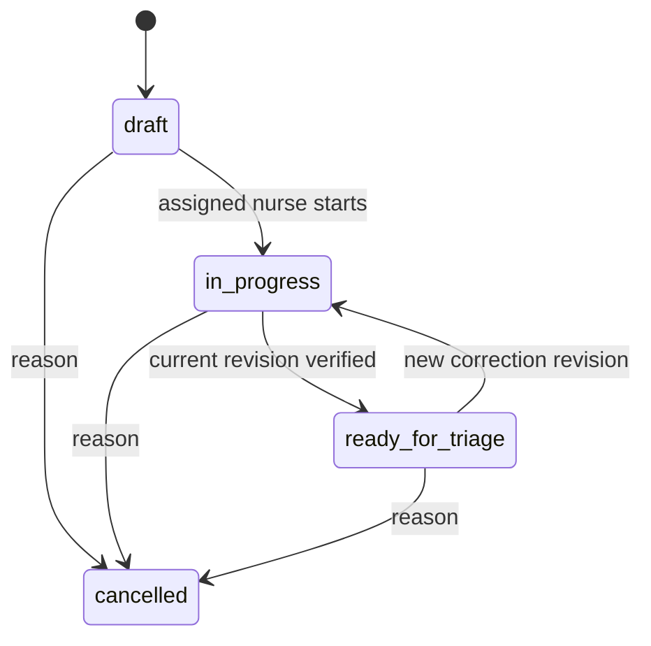
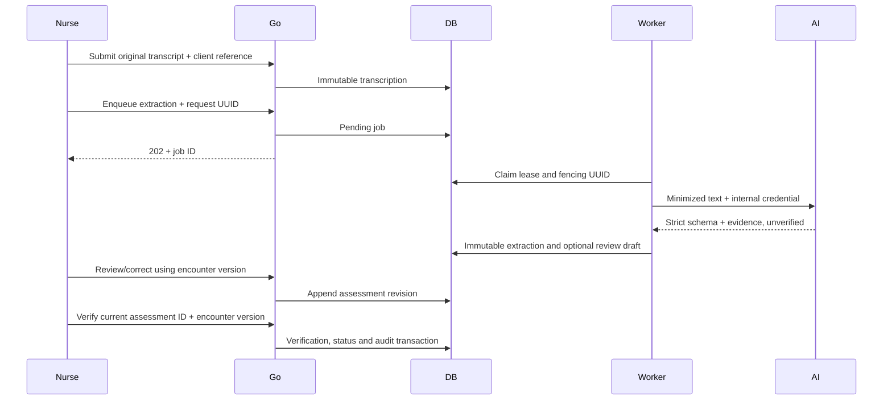
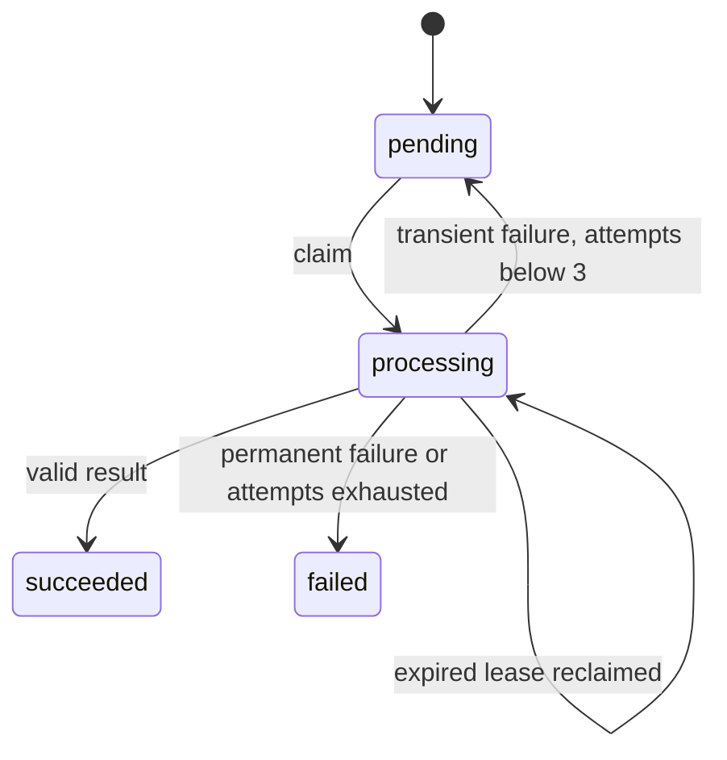

# Clinical workflow

Verification is not encounter completion. No clinical urgency or triage category is
calculated. Missing values can remain missing after explicit nurse verification.

Retry explicitly with a new request UUID; original job is preserved. Reusing a UUID
with different transcription returns 409. Worker uses 120-second lease, 75-second
HTTP deadline and maximum three claims. One job per worker process bounds concurrency.
Human work takes precedence: AI completion never replaces an existing assessment.
Manual entry has no dependency on AI availability. Corrections append a new draft;
stale version or stale verification ID returns 409.
