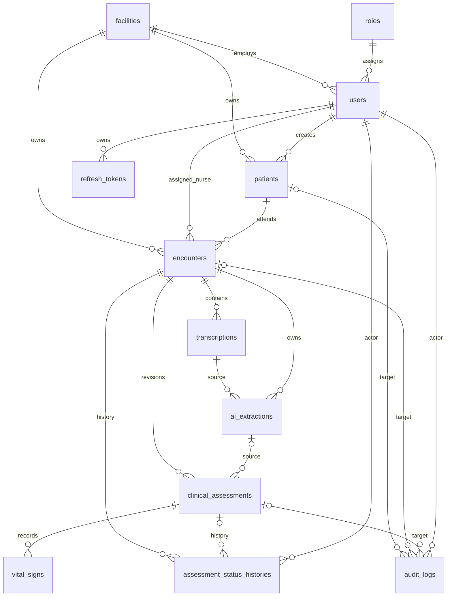

# Database schema

Migration `00002_clinical.sql` adds seven clinical tables and nullable audit links.
Phase 1 migration remains unchanged. SQLC source: `db/queries/clinical.sql`.

Composite foreign keys enforce patient/encounter facility agreement and nested
transcription/extraction/assessment encounter agreement. Encounters reference their
current assessment through `(current_assessment_id,id)`. Extraction base revision
also references an assessment in the same encounter. User foreign keys track creator
and verifier. Local MRNs are unique per facility. Temporary identity does not create
fake NIK or IHS values. Birth date is nullable and age is derived, not persisted.

Mutations lock encounter rows, compare versions, append revisions, write history and
audit within one transaction. Verified revisions retain their status and payload;
currentness is determined by encounter pointer, not by overwriting old status.
