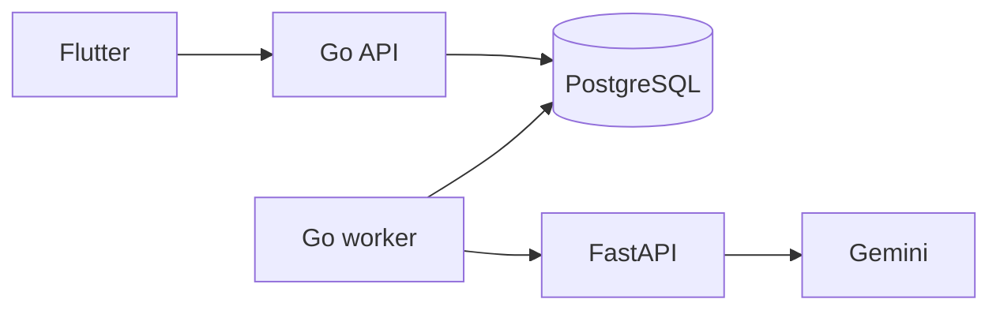

# Phase 2 implementation plan and decisions

## Baseline inspection
Phase 1 uses Gin, SQLC/pgx repositories, injected services, JWT backed by current
user state, safe JSON envelopes and Goose migrations. Build, unit tests and vet
passed during Phase 2 inspection. Database integration remains unverified initially.
Frontend is Flutter scaffold; no existing Python service exists. Existing .env is
local user configuration and must not be overwritten or printed.

## Delivery plan
1. Add forward migration, clinical SQLC queries and audit resource references.
2. Implement facility-scoped patients, nurse-owned encounters and immutable transcripts.
3. Define shared clinical schema and stateless authenticated FastAPI service.
4. Implement Gemini SDK provider, deterministic mock and strict validation.
5. Implement Go gateway, persisted jobs, bounded workers, leases and recovery.
6. Implement immutable assessment revisions and explicit nurse verification.
7. Extend Compose, contracts, tests, synthetic evaluation and deployment documentation.
8. Run all available verification; distinguish infrastructure blockers from passes.

## Decisions
- Only active nurses access clinical routes. Administrators retain account-management
  permissions; admin status does not imply clinical privileges.
- Patients are facility-scoped; encounter writes and reads require assigned nurse.
- Unknown identity uses explicit temporary identity with generated local MRN, never
  invented national identifiers. Birth date is nullable, age calculated at encounter.
- Encounter version serializes modifications. Assessment edits append revisions;
  verified payloads remain unchanged. Encounter points to current revision.
- Jobs are claimed with SKIP LOCKED, lease expiry and per-claim UUID. Completion
  checks claim ownership; duplicate remote execution cannot duplicate local revisions.
- AI completion creates a review draft only when no assessment existed at enqueue
  and no nurse assessment appeared meanwhile. Otherwise immutable extraction remains
  available for explicit nurse review without replacing current work.
- Provider defaults to mock. External processing requires explicit approval flag;
  redaction is defense in depth, not a guarantee of anonymization.
- Google SDK usage checked against https://googleapis.github.io/python-genai/:
  async client, GenerateContentConfig, response_json_schema and system_instruction.

